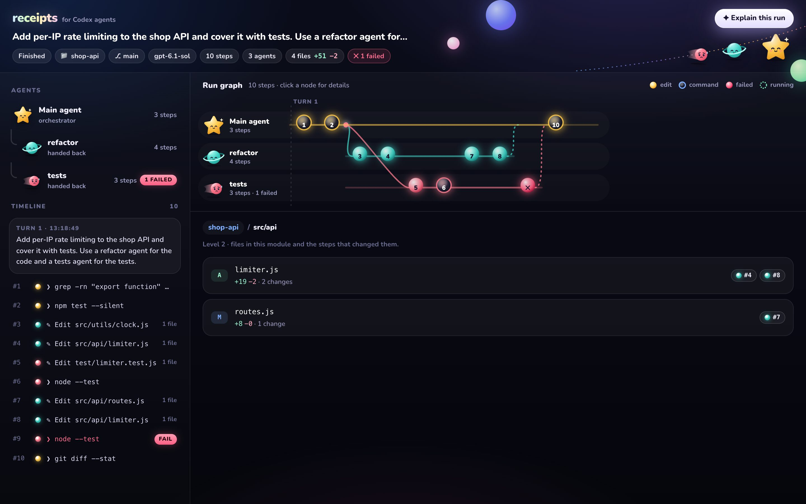
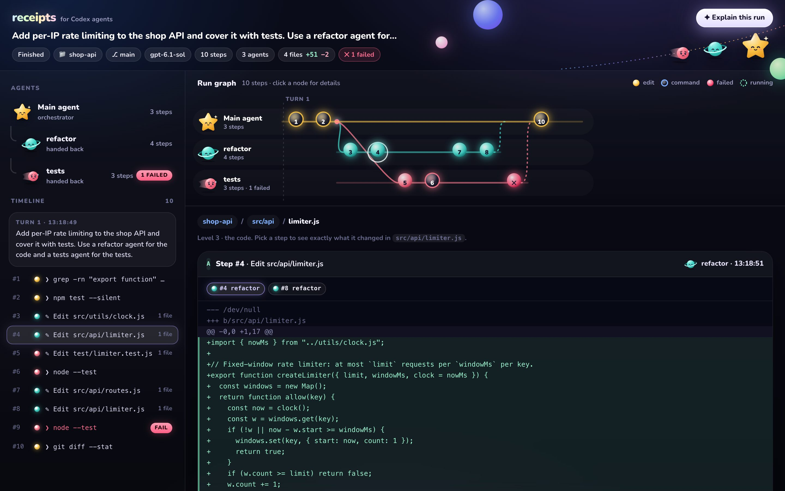
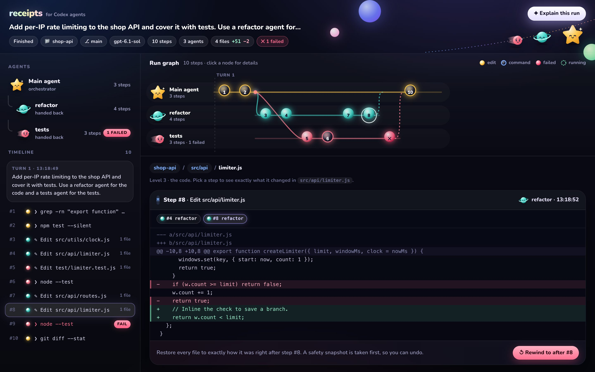
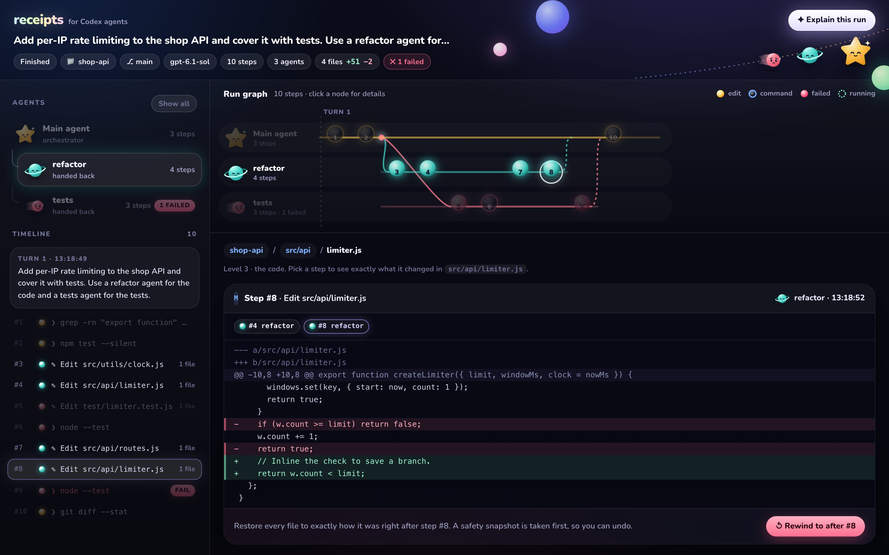
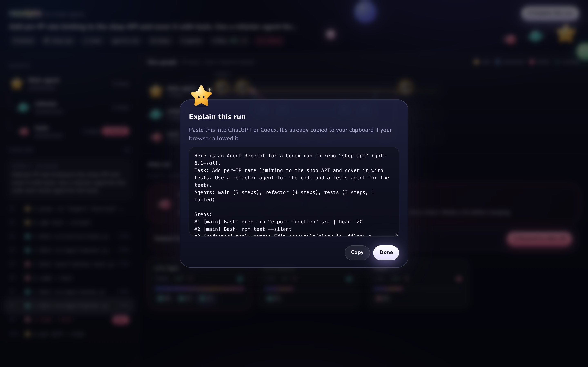

<p align="center">
  
</p>

<h1 align="center">Agent Receipts</h1>

<p align="center"><b>See what your coding agents did, step by step, and rewind your code to any step.</b></p>


Agent Receipts gives you a clear record of everything your Codex agents do. Each step is recorded: which agent ran it, what it changed, and whether it passed or failed. You can watch the work happen live as a graph, open any step to see the exact code diff, and rewind your files to any point with one click. Every rewind can be undone. It works in VS Code, Codex and ChatGPT, and never touches your git branch or your private files.

## Why

When several agents work on your code at once, it's hard to tell who changed what, and which change broke the tests. Scrolling back through a long chat doesn't help much. Agent Receipts turns the run into something you can see, click through and undo.

## Features

| | |
|---|---|
| **Live run graph** | One lane per agent and one node per step. Lines show when the main agent hands work to a subagent and when it hands back. Failed steps are red, and the step running right now pulses. |
| **Step details** | Click any node to see the exact command, its full output and which agent ran it. |
| **Diffs, three levels deep** | Go from modules → files → the exact code each step changed, or open it in VS Code's own diff editor. |
| **Root cause banner** | When tests fail, it names the steps that changed since tests last passed. |
| **One-click rewind** | Put every file back exactly as it was after any step. A safety snapshot is taken first, so you can always undo. |
| **Agent filter** | Click an agent to see only its work. |
| **Explain this run** | Builds a short summary you can paste into ChatGPT or Codex to find the root cause. |
| **Safe by design** | Snapshots live in hidden git refs. Your HEAD, branch, index, stash and ignored files like `.env` are never touched. Nothing is uploaded. |

---

## A tour of the viewer

### Read the run graph


| You see | It means |
|---|---|
| A lane with a character | One agent. **Nova** ⭐ is the main agent. **Pip** 🪐, **Comet** ☄️ and friends are subagents. |
| Filled orb | The agent edited files |
| Glass orb | The agent ran a command |
| Red orb ✕ | That step failed |
| Pulsing orb | Running right now |
| Curved line | The main agent handed work to a subagent |
| Dashed line | The subagent finished and handed back |

### Click a step to see what ran


### The diff section

The diff view works in three levels, so you can start wide and narrow down.

**Level 1: modules.** The cards at the bottom of the graph above show each folder the run touched, with lines added and removed and the steps that changed it.

**Level 2: files.** Click a module to see its files. Each file shows its added and removed lines, and a chip for every step that changed it.



**Level 3: the code.** Click a file to see its diff. Each chip at the top is one step that touched the file, so you can flip between versions. Here, step #4 creates `limiter.js`:



Then step #8 "optimises" the limit check. This is the off-by-one bug that broke the tests:



In VS Code, **Open diff in editor** shows the same change in VS Code's side-by-side diff editor.

### See one agent's work

Click an agent's lane or name. Everything else fades, so you see only what that agent did. Click again, or **Show all**, to go back.



### Rewind, and undo


**Rewind to after #N** puts every file back exactly as it was after that step. Files added later are removed. A safety snapshot is taken first, so **Undo last rewind** always works. A marker shows where you rewound to:


### Explain this run



---

## Step-by-step guide: the VS Code extension

The extension shows the live run graph in a panel beside the Codex chat. It also puts what Codex is doing right now in the status bar, and opens diffs in VS Code's native diff editor.

### Step 1: Install the extension

**Option A: from this repo (quickest).** Download [`vscode/agent-receipts.vsix`](vscode/agent-receipts.vsix), then run:

```sh
code --install-extension agent-receipts.vsix
```

Or in VS Code, open the Extensions view, click **⋯** at the top, choose **Install from VSIX…** and pick the file.

**Option B: build it yourself.** You need Node.js 22 or later.

```sh
git clone https://github.com/arnavgupta28/Agent-Recipts.git
cd Agent-Recipts
npm install
npm run build
node vscode/build.mjs
(cd vscode && ../node_modules/.bin/vsce package --no-dependencies --skip-license -o agent-receipts.vsix)
code --install-extension vscode/agent-receipts.vsix
```

Reload VS Code after installing.

### Step 2: Try the live demo (no Codex needed)

1. Open the command palette with **⌘⇧P** (**Ctrl+Shift+P** on Windows and Linux).
2. Run **Agent Receipts: Run Live Demo**, then click **Run live demo**.
3. The run graph opens beside your editor and replays a real 3-agent run. A refactor agent breaks a test on purpose, so you can try clicking steps, reading diffs and rewinding.

The demo builds a small project in `~/agent-receipts-demo`, and its tests really run.

> **Tip:** **Agent Receipts: Get Started** opens an interactive guide inside VS Code, with a button for every step.

### Step 3: Turn on recording for Codex (one time)


Run **Agent Receipts: Set Up Recording for Codex** and choose where to record:

- **This workspace's repo:** writes `<repo>/.codex/hooks.json`.
- **All repos on this machine:** writes `~/.codex/hooks.json`. It does nothing outside git repos.

Any hooks you already have are kept.

### Step 4: Trust the hooks in Codex (one time)


Codex never runs hooks you haven't approved, so you approve them once:

1. Run **Agent Receipts: Review & Trust Codex Hooks**. A terminal opens with Codex. It uses the Codex CLI on your PATH if you have one, and otherwise the copy bundled with the Codex extension.
2. In that terminal, type **`/hooks`**.
3. Review the Agent Receipts hooks and trust them.

If Codex isn't installed, the command offers to copy `npm install -g @openai/codex` for you.

### Step 5: Chat with Codex and watch it live


Start a **new** Codex chat in that repo. The run graph opens on its own when Codex starts working. The status bar shows what Codex is doing right now, and you can click it to bring the panel back.

### Step 6: Check it's working

| Check | How |
|---|---|
| Recording is on | After a Codex chat, a `.agent-receipts` folder appears in your repo. Git ignores it. |
| See past runs | **Agent Receipts: Choose Agent Run…**, or the **Runs ▾** button in the panel |
| Something's wrong | **View → Output**, then pick **Agent Receipts** from the dropdown. It logs where the hooks were written and any errors. |
| No graph appears | Make sure you trusted the hooks (step 4) and started a **new** chat after trusting them. |

### Commands

| Command | What it does |
|---|---|
| Agent Receipts: Get Started | Interactive guide with images |
| Agent Receipts: Open Run Graph | Shows the panel |
| Agent Receipts: Run Live Demo | Replays a 3-agent run, no Codex needed |
| Agent Receipts: Set Up Recording for Codex | Writes the hooks |
| Agent Receipts: Review & Trust Codex Hooks | Opens Codex's `/hooks` review |
| Agent Receipts: Choose Agent Run… | Switches between recorded runs |

### Settings

| Setting | Default | Meaning |
|---|---|---|
| `agentReceipts.autoOpen` | `true` | Open the graph when a new Codex run starts |
| `agentReceipts.demoDelayMs` | `1500` | Pause between steps in the live demo |

> The Codex engine bundled with the VS Code extension (0.162) has removed plugin-bundled hooks (`plugin_hooks: removed`). Hooks must live in a `hooks.json` config file, which is what the setup command writes.

---

## Other ways to use it

### Quick start in the browser (no Codex, no VS Code)

```sh
npm install
npm run build
node dist/cli.js simulate          # builds ./demo-shop-api, records a 3-agent run, opens the viewer
node dist/cli.js simulate --live   # same run replayed slowly, so you watch the graph grow live
```

The simulated run is real. The refactor agent introduces an off-by-one bug, and `node --test` really fails. Click **Rewind to after #6** and the tests pass again.

### With Codex CLI or ChatGPT

**Option A: as a plugin** (hooks + skill + MCP server + file viewer)

This folder is a Codex plugin (`.codex-plugin/plugin.json`) and a local marketplace (`.agents/plugins/marketplace.json`). Add it as a local plugin source in Codex, install **Agent Receipts** from `/plugins`, then run `/hooks` and trust its hooks. Start a new session.

**Option B: hooks + MCP server directly**

```sh
node dist/cli.js install --cwd /path/to/your/repo     # writes <repo>/.codex/hooks.json
codex mcp add agent-receipts -- node "$(pwd)/dist/server.js"
```

Then run `/hooks` in Codex and trust them. Ask Codex *"show me the receipt"*, or open `<repo>/.agent-receipts/*.receipt`.

### CLI

```sh
node dist/cli.js list     --cwd <repo>
node dist/cli.js export   --cwd <repo> [--session ID]
node dist/cli.js view     [file.receipt] [--cwd <repo>] [--port N]
node dist/cli.js rewind   --to <snapshot> --cwd <repo>     # prints an undo command
```

---

## How it works

1. **Hooks** record every Codex tool call: which agent ran it, its input and output, and whether it passed or failed. The hook always exits 0, so it can never break the agent.
2. **Hidden git snapshots** are taken after each step in `refs/agent-receipts/*`, using a private git index. Your HEAD, branch, index and stash are never touched, and ignored files like `.env` are never captured or changed.
3. **A receipt** (`.receipt` file) is built from the events and snapshots.
4. **The viewer** shows the receipt as a live graph, in VS Code, in ChatGPT and the Codex app (as an MCP App), or in your browser.

| Piece | File |
|---|---|
| Hook entry (stdin JSON → event + snapshot, always exits 0) | `src/hook.ts`, `src/recorder.ts` |
| Snapshots and restore through a private git index | `src/git.ts`, `src/rewind.ts` |
| Receipt builder | `src/receipt.ts` |
| MCP server: `receipts.open` (file viewer), `receipts.show`, `receipts.list`, `receipts.rewind` | `src/server.ts` |
| Viewer UI (MCP App, or browser via `view`) | `src/ui/` |
| VS Code extension | `vscode/` |

Storage: `<repo>/.git/agent-receipts/<session>/` holds events, plus `<repo>/.agent-receipts/*.receipt`, which is added to `.git/info/exclude`.

## Tests

```sh
npm run build && npm test
```

The tests cover receipt correctness, rewind and undo, deleting agent-created files, protecting ignored files, rejecting non-snapshot commits, secret redaction, and the hook never failing the agent.

## Docs

Requirements, architecture, build plan, demo script and research notes are in [`docs/`](docs/). Start with [docs/01-PRD.md](docs/01-PRD.md). Meet the cast in [docs/characters.html](docs/characters.html).

To refresh the README screenshots, run `npm run build && node scripts/screenshots.mjs`. It needs Google Chrome.
