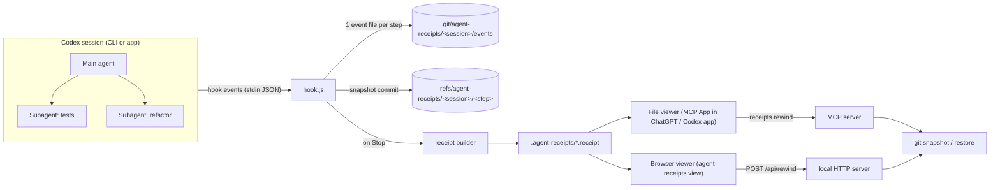

# Agent Receipts: Architecture

## 0. Primary surface: VS Code

The main surface is a VS Code extension in `agent-receipts/vscode/`. A webview panel sits beside the Codex chat, and a status bar item shows the current step. Diffs open in VS Code's native diff editor through a virtual document provider that reads snapshot commits.

The extension polls `.git/agent-receipts/` once a second and pushes the rebuilt receipt to the webview. Hooks are written to `hooks.json`, because Codex 0.162 removed plugin-bundled hooks. Each hook command uses an absolute `node` path, so it works even when VS Code doesn't inherit your shell's PATH.

## 1. Components



| Component | File | Job |
|---|---|---|
| Hook | `src/hook.ts` | Reads one hook event from stdin, records it, snapshots, never fails |
| Store | `src/store.ts` | Paths, event files, session listing |
| Git snapshots | `src/git.ts` | Snapshot, diff, restore, using a private index |
| Receipt builder | `src/receipt.ts` | Turns events + snapshots into one receipt JSON |
| MCP server | `src/server.ts` | `receipts.open`, `receipts.show`, `receipts.rewind`, UI resources |
| CLI | `src/cli.ts` | `list`, `export`, `view`, `rewind`, `install`, `simulate` |
| Viewer UI | `src/ui/` | One HTML page. Talks to the MCP host or to the local HTTP server. |
| Skill | `skills/agent-receipts/SKILL.md` | Tells Codex when and how to use receipts |

## 2. Plugin layout (Codex plugin format)

```
agent-receipts/
├── .codex-plugin/plugin.json   # name, skills, mcpServers, hooks, interface
├── .mcp.json                   # stdio server: node ./dist/server.js
├── hooks/hooks.json            # SessionStart, UserPromptSubmit, PostToolUse, SubagentStart/Stop, Stop
├── skills/agent-receipts/SKILL.md
├── dist/                       # built JS: hook.js, server.js, cli.js, viewer.html
└── src/
```

Hooks run `node "$PLUGIN_ROOT/dist/hook.js"`. Codex sets `PLUGIN_ROOT` for plugin-bundled hooks.

## 3. Hook events used

All payloads are JSON on stdin. Fields come from Codex's generated hook schemas in `codex-rs/hooks/schema/generated`.

| Event | Fields we use | Action | Mode |
|---|---|---|---|
| `SessionStart` | `session_id`, `cwd`, `model`, `source` | Baseline snapshot, session meta | sync |
| `UserPromptSubmit` | `turn_id`, `prompt`, `agent_id?` | Record turn | sync |
| `PreToolUse` | `tool_name`, `tool_use_id`, `tool_input`, `agent_id?` | Mark step as running (live graph) | async |
| `PostToolUse` | `turn_id`, `tool_name`, `tool_use_id`, `tool_input`, `tool_response`, `agent_id?`, `agent_type?` | Record step, snapshot | sync |
| `SubagentStart` | `agent_id`, `agent_type`, `turn_id` | Record agent | async |
| `SubagentStop` | `agent_id`, `last_assistant_message` | Close agent | async |
| `Stop` | `last_assistant_message` | Build `.receipt` | async |

Subagent hooks carry the **parent** `session_id`, so one session folder holds the whole agent tree.

## 4. Storage

```
<repo>/.git/agent-receipts/<session_id>/
  index                    # private git index (incremental snapshots)
  meta.json                # repo, model, start time
  events/<ns-time>-<rand>.json   # one file per event, no locking needed
<repo>/.agent-receipts/<date>-<short-id>.receipt   # excluded via .git/info/exclude
refs/agent-receipts/<session_id>/<event-id>        # snapshot commits
```

Hidden refs keep snapshot commits alive against `git gc`. They never appear in `git branch` or `git log`.

## 5. Snapshot and restore

**Snapshot** (no effect on HEAD, branch, real index):
```sh
GIT_INDEX_FILE=$SESSION/index git add -A          # respects .gitignore
tree=$(GIT_INDEX_FILE=$SESSION/index git write-tree)
# skip if tree == previous snapshot's tree
commit=$(git commit-tree $tree -p <prev> -m "agent-receipts step")
git update-ref refs/agent-receipts/<session>/<event> $commit
```

**Restore to snapshot T**:
1. Take a safety snapshot `S` of the current tree and record a `rewind` event pointing to it.
2. Delete files present in `S` but not in `T`.
3. `GIT_INDEX_FILE=tmp git read-tree T && GIT_INDEX_FILE=tmp git checkout-index -a -f`
4. Undo = restore to `S`.

## 6. Receipt format (v1)

```jsonc
{
  "version": 1,
  "session": { "id": "…", "model": "gpt-6.1-sol", "startedAt": "…", "title": "first prompt" },
  "repo": { "root": "/path", "name": "app", "branch": "main", "head": "abc123" },
  "agents": [{ "id": "main", "type": "main", "parent": null, "steps": 6, "lastMessage": null }],
  "turns":  [{ "id": "t1", "prompt": "Add rate limiting…", "at": "…" }],
  "steps": [{
    "n": 3, "id": "evt", "at": "…", "turn": "t1", "agent": "agent-2",
    "tool": "apply_patch", "title": "Edit src/api/limiter.ts",
    "input": "…preview…", "output": "…preview…", "failed": false,
    "snapshot": "commit-sha", "files": [{ "path": "src/api/limiter.ts", "status": "M", "add": 12, "del": 3, "diff": "…" }]
  }],
  "modules": [{ "path": "src/api", "files": ["src/api/limiter.ts"], "steps": [3, 5], "agents": ["agent-2"] }],
  "rewinds": [{ "at": "…", "toStep": 3, "safety": "commit-sha" }],
  "stats": { "steps": 9, "filesChanged": 5, "commands": 4, "failures": 1 }
}
```

## 7. MCP tools

| Tool | Visible to | Entrypoint | Annotations |
|---|---|---|---|
| `receipts.open` | app + host | `file` for `.receipt` | read-only |
| `receipts.show` | model | inline widget | read-only. Arg: `cwd`, optional `session` |
| `receipts.rewind` | app only | none | destructive. Args: `receiptPath` or `cwd`, `session`, `snapshot` |

UI resources use MIME type `text/html;profile=mcp-app`. The viewer reads `structuredContent` from the tool result, or reads the opened file with `openaiExtensions.resources.read`.

## 8. Viewer layout

```
┌───────────────────────────────────────────────────────────────┐
│ Header: title · model · branch · 9 steps · 5 files · 1 failed │  [Explain this run]
├───────────────┬───────────────────────────────────────────────┤
│ Agents        │  Map   L1 modules → L2 files → L3 diff        │
│  ● main       │  breadcrumb: src / api / limiter.ts           │
│   ├ tests     │                                               │
│   └ refactor  │  [module cards]  or  [file rows] or [diff]    │
├───────────────┤                                               │
│ Timeline      │                         [Rewind to after #3]  │
│  Turn 1       │                                               │
│   #1 shell …  │                                               │
│   #2 patch …  │                                               │
└───────────────┴───────────────────────────────────────────────┘
```

**Transport abstraction:** the UI calls `api.rewind(...)` and `api.explain(...)`. In ChatGPT these use `app.callServerTool` and `openaiExtensions.message.send`. In the browser they use `fetch('/api/…')` and copy the prompt to the clipboard.

## 9. Failure detection

A step is `failed` when any of these hold:
- `tool_response` has a non-zero `exit_code`, `exitCode` or `status`.
- Output text matches `Exit code: N` with N ≠ 0, or `Process exited with code N`.
- The response has an `error` field or `success: false`.
