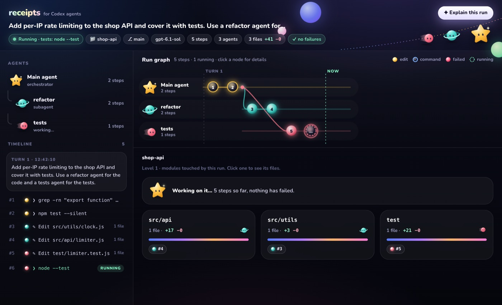
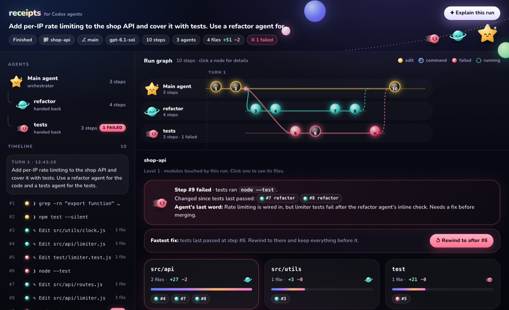
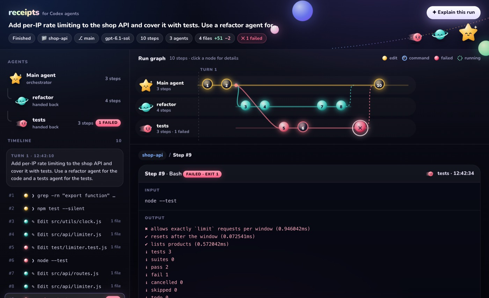
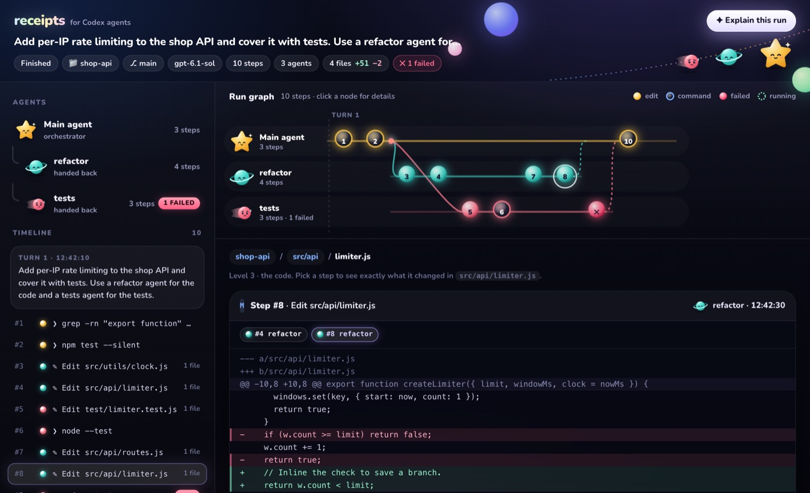
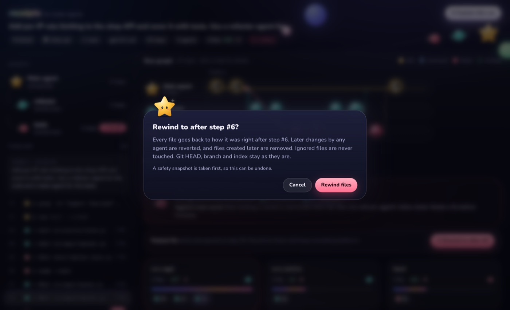
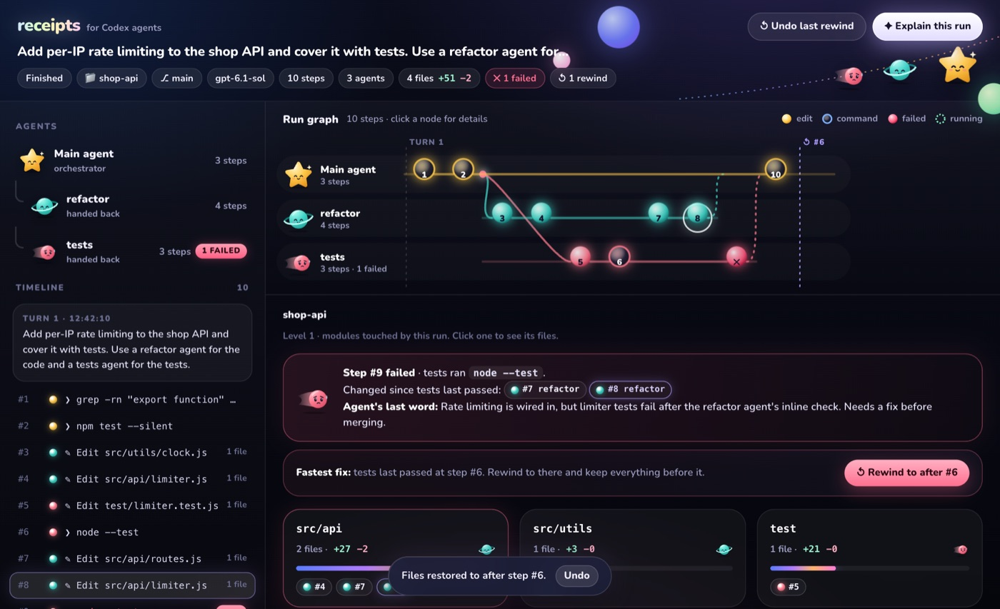
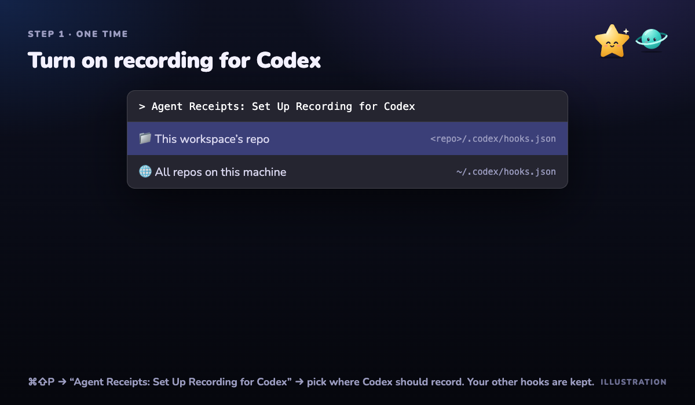
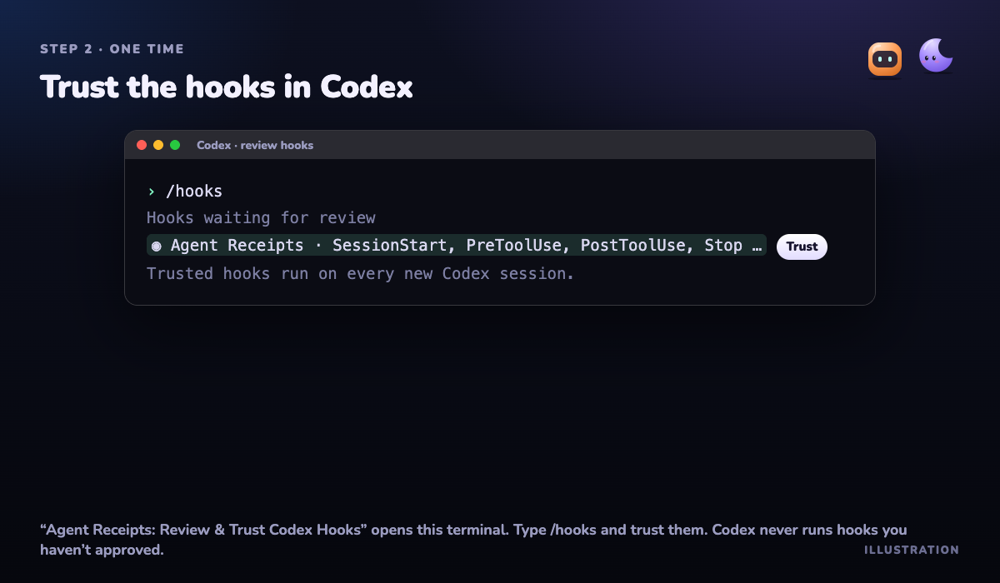
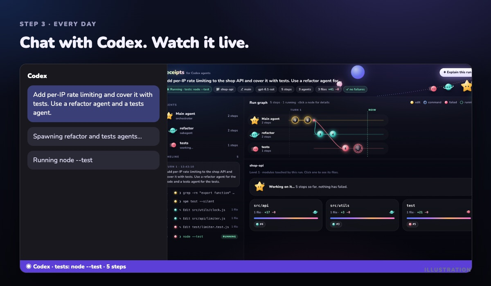

# Agent Receipts for Codex

**See what your Codex agents did, step by step and agent by agent, and rewind your files to any step.** A live run graph opens beside the Codex chat while it works.

> **Fastest way to learn it:** run **Agent Receipts: Get Started** from the command palette (⌘⇧P). It's an interactive guide with a button for every step.

---

## 1. Try it in 30 seconds (no Codex needed)

1. Open the command palette with **⌘⇧P**.
2. Run **Agent Receipts: Run Live Demo**, then click **Run live demo**.
3. The run graph opens beside your editor and replays a real 3-agent run. One agent breaks a test on purpose.

The demo builds a small project in `~/agent-receipts-demo`, and its tests really run.

## 2. Read the run graph

| You see | It means |
|---|---|
| A lane with a character | One agent. **Nova** ⭐ is the main agent. **Pip** 🪐, **Comet** ☄️ and friends are subagents. |
| Filled orb | The agent edited files |
| Glass orb | The agent ran a command |
| Red orb ✕ | That step failed |
| Pulsing orb | Running right now |
| Curved line | The main agent handed work to a subagent |
| Dashed line | The subagent finished and handed back |

The red banner names the steps that changed since tests last passed. These are usually the cause.

## 3. Click a step to see what ran

Click any node or timeline row to see the exact command, its full output and which agent ran it.

## 4. Drill down to the exact diff

- Go from **modules → files → code**. Each tab is a step that touched the file.
- **Open diff in editor** opens VS Code's own side-by-side diff.
- Click an agent's lane or name to see only that agent's work.

## 5. Rewind, and undo

- **Rewind to after #N** puts every file back exactly as it was after that step. Files added later are removed.
- A safety snapshot is taken first, so **Undo last rewind** always works.
- Your git HEAD, branch, index, stash and ignored files such as `.env` are never touched.

---

## Use it with your real Codex chats

### Step 1: turn on recording (one time)

Run **Agent Receipts: Set Up Recording for Codex** and choose:
- **This workspace's repo:** writes `<repo>/.codex/hooks.json`.
- **All repos on this machine:** writes `~/.codex/hooks.json`. It does nothing outside git repos.

Any hooks you already have are kept.

### Step 2: trust the hooks in Codex (one time)

Run **Agent Receipts: Review & Trust Codex Hooks**. A terminal opens with Codex. It uses the Codex CLI on your PATH if you have one, and otherwise the copy bundled with the Codex extension. Type **`/hooks`** and trust the Agent Receipts hooks. Codex never runs hooks you haven't approved.

### Step 3: chat with Codex and watch it live

Start a **new** Codex chat in that repo. The run graph opens on its own when Codex starts working. The status bar shows what it's doing right now, and you can click it to bring the panel back.

---

## Check it's working

| Check | How |
|---|---|
| Recording is on | After a Codex chat, a `.agent-receipts` folder appears in your repo. Git ignores it. |
| See past runs | **Agent Receipts: Choose Agent Run…**, or the **Runs ▾** button in the panel |
| Something's wrong | **View → Output**, then pick **Agent Receipts** from the dropdown. It logs where the hooks were written and any errors. |
| No graph appears | Make sure you trusted the hooks (step 2) and started a **new** chat after trusting them |

## Commands

| Command | What it does |
|---|---|
| Agent Receipts: Get Started | Interactive guide with images |
| Agent Receipts: Open Run Graph | Shows the panel |
| Agent Receipts: Run Live Demo | Replays a 3-agent run, no Codex needed |
| Agent Receipts: Set Up Recording for Codex | Writes the hooks |
| Agent Receipts: Review & Trust Codex Hooks | Opens Codex's `/hooks` review |
| Agent Receipts: Choose Agent Run… | Switches between recorded runs |

## Settings

| Setting | Default | Meaning |
|---|---|---|
| `agentReceipts.autoOpen` | `true` | Open the graph when a new Codex run starts |
| `agentReceipts.demoDelayMs` | `1500` | Pause between steps in the live demo |

Everything stays on your machine. Nothing is uploaded.
